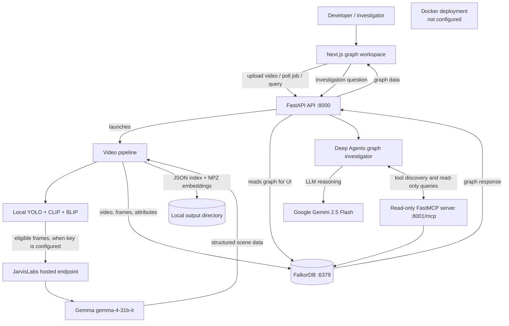

# ArgusGraph

**Turn CCTV footage into an explorable, evidence-linked graph.**

ArgusGraph samples video, enriches frames with computer vision and scene descriptions, stores the resulting frame attributes in FalkorDB, and presents the graph in a browser-based investigation workspace.

Three technologies define the current implementation:

- **JarvisLabs + Gemma** provide hosted, image-and-text scene analysis for eligible frames.
- **Gemini 2.5 Flash** powers a separate graph-investigation agent that retrieves evidence through read-only MCP tools.
- **Docker is not configured yet.** The repository currently has no Dockerfile or Compose file; the services run as separate local processes.

[](#gemma-the-vision-model)
[](#jarvislabs-hosted-inference)
[](./frontend/package.json)
[](#docker-deployment-status)

> **Project status:** The pipeline and graph UI are implemented. Model credentials are currently hard-coded as empty constants, and the chat agent cannot be enabled through environment variables as committed. See [Configuration](#configuration) before expecting model-backed results.

## Contents

- [Highlights](#highlights)
- [JarvisLabs-hosted inference](#jarvislabs-hosted-inference)
- [Gemma: the vision model](#gemma-the-vision-model)
- [Docker deployment status](#docker-deployment-status)
- [Architecture and data flow](#architecture-and-data-flow)
- [Features](#features)
- [Technology stack](#technology-stack)
- [Repository layout](#repository-layout)
- [Prerequisites](#prerequisites)
- [Quick start](#quick-start)
- [Configuration](#configuration)
- [Usage and API](#usage-and-api)
- [Testing and validation](#testing-and-validation)
- [Troubleshooting](#troubleshooting)
- [Security](#security)
- [Limitations and roadmap](#limitations-and-roadmap)
- [Contributing](#contributing)
- [License](#license)

## Highlights

- Convert sampled CCTV frames into a `Video → Frame → FrameAttribute` graph.
- Combine YOLO detections, CLIP and BLIP visual processing, and optional Gemma scene descriptions.
- Browse graph nodes and attributes in an interactive Cytoscape.js workspace.
- Ask evidence-grounded questions through a Deep Agents agent and read-only FalkorDB MCP tools.
- Keep visual embeddings in local compressed NPZ files rather than writing them into FalkorDB.

## JarvisLabs-hosted inference

The video pipeline calls the OpenAI-compatible endpoint at `https://models.jarvislabs.net/v1` directly. JarvisLabs is the configured **hosted inference service**; it is not an in-repository agent framework or the graph-question-answering model.

For frames with more than one YOLO detection, the pipeline can send the sampled image, detections, and BLIP caption to the configured Gemma model. Gemma returns structured scene fields that are saved to the JSON index and flattened into graph attributes. If inference is unavailable, the pipeline records a BLIP/YOLO fallback instead.

The API key is currently declared as an empty `JARVISLABS_API_KEY` constant in [`backend/video_pipeline.py`](./backend/video_pipeline.py). It is **not** read from `.env` or an environment variable. As checked in, eligible frames therefore use fallback descriptions unless that configuration is changed locally. Do not commit credentials; adding proper environment-based secret configuration is a needed follow-up.

## Gemma: the vision model

The pipeline configures the model identifier **`gemma-4-31b-it`** and sends a multimodal chat-completion request containing both a text prompt and a base64-encoded JPEG frame. The request is made to the remote JarvisLabs endpoint; model weights are not downloaded or served by this repository.

Gemma's project-specific role is to produce a validated JSON scene description with `scene_type`, `activities`, `safety_concerns`, `visible_evidence`, and `uncertainty`. It is only requested for frames marked eligible by the pipeline's detection-count check. The pipeline does not establish a hardware requirement for remote Gemma inference. Its local YOLO, CLIP, and BLIP components use CUDA when PyTorch reports it available and otherwise run on CPU. YOLO weights are obtained through Ultralytics; the CLIP and BLIP checkpoints are loaded from Hugging Face.

## Docker deployment status

**Docker is not currently part of the runnable project setup.** There is no Dockerfile, Compose configuration, configured container network, or Docker-managed data volume in the repository. Run the frontend, FastAPI API, MCP server, and FalkorDB as separately managed services for local development.

The Gemma endpoint remains remote regardless of how the application is packaged. A future container setup would need to configure service-to-service addresses and persist uploaded videos and pipeline outputs deliberately; containerizing the app alone would not include Gemma weights, grant GPU access, or provide a FalkorDB database. Until those files exist, there is no supported `docker build` or `docker compose` command for ArgusGraph.

## Architecture and data flow



The upload API starts the existing video pipeline as a background task. The pipeline samples baseline and visually changed frames, runs local visual models, optionally requests Gemma scene analysis, writes JSON and embedding artifacts, and attempts to ingest the frame records into FalkorDB. For graph questions, the separate agent uses the MCP server to retrieve bounded records from FalkorDB; Gemini 2.5 Flash is the configured reasoning model. The Docker node is intentionally disconnected because no Docker runtime is implemented in this repository.

## Features

- Adaptive frame sampling based on a baseline interval and visual-change threshold.
- YOLO object detections, CLIP and BLIP features, and BLIP image captions.
- Optional hosted Gemma scene analysis with a schema-validated response and local fallback.
- FalkorDB ingestion using `Video`, `Frame`, and `FrameAttribute` nodes.
- Read-only MCP tools for graph overview, search, frame details, temporal context, and restricted Cypher.
- Browser graph exploration, video uploads, job status, and evidence-oriented agent chat.
- Session and job state are in memory; they reset when the API process restarts.

## Technology stack

| Area | Technologies in this repository |
| --- | --- |
| Frontend | Next.js 16.4.0, React 19, TypeScript, Cytoscape.js |
| API and processing | Python, FastAPI, OpenCV, PyTorch, Ultralytics YOLO, Hugging Face Transformers |
| Frame enrichment | CLIP (`openai/clip-vit-base-patch32`), BLIP (`Salesforce/blip-image-captioning-base`) |
| Hosted scene inference | JarvisLabs OpenAI-compatible endpoint, Gemma `gemma-4-31b-it` |
| Graph investigation | Deep Agents, LangChain MCP adapters, Google Gemini `gemini-2.5-flash` |
| Graph storage and tools | FalkorDB, FastMCP |
| Containerization | Not configured |

## Repository layout

```text
backend/
  main.py                 FastAPI upload, job, graph, and agent API
  video_pipeline.py       Video sampling, enrichment, Gemma calls, ingestion
  build_graph.py          JSON-index-to-FalkorDB graph utility
  requirements.txt        Main Python dependencies
  Agent/
    main.py               Standalone agent entry point
    requirements.txt      MCP server dependencies
    MCP/
      server.py           Read-only FalkorDB MCP tools (port 8001)
      client.py           MCP overview smoke-test client
  Videos/                 Sample CCTV clips
frontend/
  app/page.tsx            Graph workspace and upload/chat UI
  package.json            Frontend scripts and dependencies
```

## Prerequisites

- Python **3.10 or newer** (the code uses Python 3.10 type syntax); no exact tested Python version is declared.
- Node.js compatible with Next.js 16 and pnpm **12.3.4**, as specified by the frontend package.
- A reachable FalkorDB instance. The code defaults to `localhost:6379`; no database service configuration is included.
- Network access to download local model weights on first use.
- Optional: credentials for the configured JarvisLabs inference endpoint and Google Gemini. Their current source configuration limitation is described below.

The Python requirements files do not currently declare every runtime command dependency. The install command below explicitly includes Uvicorn, `python-multipart`, and the OpenAI-compatible client imported by the pipeline.

## Quick start

### 1. Clone the repository

```powershell
git clone https://github.com/areenphadtare/Agentic-AI-hackathon.git
Set-Location Agentic-AI-hackathon
```

### 2. Install Python dependencies

From the repository root, create and activate a virtual environment, then install both project requirement files and the missing runtime packages:

```powershell
py -3 -m venv .venv
.\.venv\Scripts\Activate.ps1
python -m pip install --upgrade pip
python -m pip install -r backend\requirements.txt -r backend\Agent\requirements.txt uvicorn python-multipart openai
```

On macOS/Linux, use `python3 -m venv .venv` and activate with `source .venv/bin/activate`; the pip command is otherwise the same with forward-slash paths.

### 3. Start FalkorDB

Start FalkorDB separately and make it reachable at `localhost:6379`, or set the connection variables in the shell where you start each Python process. This repository does not provide a database container or Compose file.

### 4. Start the MCP server

Open a terminal at the repository root:

```powershell
python backend\Agent\MCP\server.py
```

By default, the server listens on `0.0.0.0:8001` and exposes Streamable HTTP at `http://127.0.0.1:8001/mcp`.

### 5. Start the API

In another terminal, from the repository root, activate the same virtual environment and run:

```powershell
python -m uvicorn backend.main:app --reload --port 8000
```

Check the API at <http://127.0.0.1:8000/health>. Interactive API documentation is available at <http://127.0.0.1:8000/docs>.

### 6. Start the frontend

In another terminal:

```powershell
Set-Location frontend
corepack pnpm install --frozen-lockfile
corepack pnpm dev -- --port 3001
```

Open <http://localhost:3001>. The frontend defaults to the API at `http://127.0.0.1:8000`; set `NEXT_PUBLIC_ARGUSGRAPH_API_URL` before starting the dev server to use another API URL.

### 7. Try the pipeline

Upload a short `.mp4`, `.mov`, `.avi`, `.mkv`, `.webm`, or `.m4v` clip in the UI. The API returns a job ID and runs processing in the background. A successful job reports a graph and frame summary. With the committed empty JarvisLabs key, eligible frames use the BLIP/YOLO fallback; graph ingestion still requires FalkorDB.

The included sample videos are [`CCTV_Feed_1.mp4`](./backend/Videos/CCTV_Feed_1.mp4) and [`CCTV_Feed_2.mp4`](./backend/Videos/CCTV_Feed_2.mp4).

## Configuration

The application reads the following environment variables where noted. Defaults assume all local services are reachable from the same machine.

There is no `.env.example`. For non-secret settings, you can create `backend/.env` (ignored by Git) with entries such as:

```dotenv
FALKORDB_HOST=localhost
FALKORDB_PORT=6379
FALKORDB_GRAPH_NAME=video_graph
FALKORDB_GRAPH=video_graph
```

The API and MCP server load this file; the API passes its environment to the pipeline subprocess. Alternatively, set variables in the shell before starting the relevant process.

| Variable | Default | Used by |
| --- | --- | --- |
| `FALKORDB_HOST` | `localhost` | API, pipeline, MCP server |
| `FALKORDB_PORT` | `6379` | API, pipeline, MCP server |
| `FALKORDB_PASSWORD` | unset | API, pipeline, MCP server |
| `FALKORDB_GRAPH_NAME` | `video_graph` | FastAPI API |
| `FALKORDB_GRAPH` | `video_graph` | MCP server and `build_graph.py` |
| `MCP_HOST` | `0.0.0.0` | MCP server bind address |
| `MCP_PORT` | `8001` | MCP server port |
| `ARGUSGRAPH_MCP_URL` | `http://127.0.0.1:8001/mcp` | FastAPI agent |
| `ARGUSGRAPH_AGENT_MODEL` | `gemini-2.5-flash` | FastAPI agent |
| `ARGUSGRAPH_MAX_HISTORY_TURNS` | `6` | FastAPI agent |
| `ARGUSGRAPH_UPLOAD_DIR` | `<repo>/uploads` | FastAPI API |
| `ARGUSGRAPH_OUTPUT_DIR` | `<repo>/argusgraph_output` | FastAPI API |
| `ARGUSGRAPH_PIPELINE_SCRIPT` | `<repo>/backend/video_pipeline.py` | FastAPI API |
| `ARGUSGRAPH_PYTHON` | Current interpreter, or project `venv` if found | Pipeline subprocess |
| `CORS_ORIGINS` | `http://localhost:3001,http://127.0.0.1:3001` | FastAPI API |
| `NEXT_PUBLIC_ARGUSGRAPH_API_URL` | `http://127.0.0.1:8000` | Frontend |

When overriding the graph name, keep `FALKORDB_GRAPH_NAME` and `FALKORDB_GRAPH` aligned so the API and MCP server read the same graph.

### Model credentials: current limitation

- **Gemma:** `backend/video_pipeline.py` has an empty `JARVISLABS_API_KEY` constant. It does not load `.env` or a similarly named environment variable.
- **Graph Q&A agent:** `backend/main.py` has an empty `GOOGLE_API_KEY` constant. Although the startup error mentions `GOOGLE_API_KEY` or `GEMINI_API_KEY` in `.env`, the current code does not read either variable.

As committed, the video pipeline can run without the hosted Gemma credential by using fallback descriptions, but the graph-investigation agent will report as unavailable. Do not put real credentials in committed source or publish them. A secure environment-based configuration path is not implemented yet.

## Usage and API

The browser UI supports video upload, processing status, graph exploration, node inspection, and evidence questions. FastAPI publishes the interactive schema at `/docs`.

| Method | Path | Purpose |
| --- | --- | --- |
| `GET` | `/health` | API liveness response |
| `GET` | `/api/agent/status` | Agent readiness and initialization error |
| `POST` | `/api/videos/upload` | Accept a video and queue pipeline processing |
| `GET` | `/api/jobs/{job_id}` | Read in-memory job state and result |
| `GET` | `/api/jobs/{job_id}/frames` | Read frames after a job completes |
| `GET` | `/api/videos/{video_id}/graph` | Return graph data for a video |
| `POST` | `/api/agent/query` | Ask the graph-investigation agent |
| `POST` | `/api/agent/reset` | Clear in-memory session context |

MCP tools are served separately at `/mcp` on port `8001`. The UI's video graph is populated from the completed upload job; the API does not expose a general list-videos route.

## Testing and validation

There is no automated test suite in the repository. Useful local checks are:

```powershell
# From the repository root: Python syntax check
python -m compileall backend

# From frontend\: production build
Set-Location frontend
corepack pnpm build
```

To verify the running services, request `http://127.0.0.1:8000/health`, check `http://127.0.0.1:8000/docs`, and inspect `/api/agent/status`. A full upload test additionally needs a reachable FalkorDB instance and local model dependencies; Gemma scene descriptions and graph Q&A need their respective credentials and currently have the configuration limitation above.

## Troubleshooting

| Symptom | Checks |
| --- | --- |
| Upload fails or API does not start | Install `python-multipart` and Uvicorn; confirm the API is listening on port `8000`. |
| Browser cannot reach the API | Confirm `NEXT_PUBLIC_ARGUSGRAPH_API_URL` and `CORS_ORIGINS`; the default frontend port is `3001`. |
| Pipeline cannot connect to FalkorDB | Verify FalkorDB is running and `FALKORDB_HOST`, `FALKORDB_PORT`, password, and graph names match across API and MCP processes. |
| Graph job fails after processing | Read the job's `error`, `stdout`, and `stderr`; confirm graph ingestion succeeded and the configured graph contains the uploaded video's ID. |
| Gemma results are fallback descriptions | Hosted inference is not configured with the committed empty API-key constant. |
| Agent chat returns service unavailable | Check `/api/agent/status`, the MCP server URL, discovered tools, and the blank Google API-key constant in `backend/main.py`. |
| First processing run is slow | YOLO, CLIP, and BLIP weights are downloaded as needed; local inference can run on CPU if CUDA is unavailable. |
| Job disappears after restart | Job state and chat history are in memory and are not durable. |

## Security

- Do not commit or paste model credentials into source control. The current hard-coded credential placeholders need a secure environment-based replacement before shared or production deployment.
- The MCP server exposes graph-read tools, including a restricted read-only Cypher tool. Do not expose it publicly without network access controls.
- Uploaded videos, extracted frames, JSON indexes, and embedding files can contain sensitive content. Treat the default `uploads/` and `argusgraph_output/` directories accordingly; no retention or deletion policy is implemented.
- API jobs and agent sessions are in-memory and the local development API has no authentication configured.
- Model-generated captions, detections, and scene descriptions are observations, not verified identity or intent. The agent's system prompt instructs it to cite graph evidence and avoid unsupported conclusions.

## Limitations and roadmap

Current limitations visible in the repository:

- No Dockerfile or Compose deployment.
- Model credentials are empty source constants rather than supported environment configuration.
- No automated tests, persistent job queue, durable chat history, or authentication.
- FalkorDB must be provisioned separately; data persistence and backup are the operator's responsibility.
- Local model resource requirements and end-to-end performance are not benchmarked.

Potential follow-up work (not implemented): add secret-safe environment configuration, a reproducible Docker Compose stack with explicit persistent volumes, automated API/pipeline tests, and durable job/session storage.

## Contributing

Contributions are welcome. Open an issue to discuss substantial changes, keep pull requests focused, and include validation steps for behavior changes. No separate contribution guide or code of conduct is currently present.

## License

No `LICENSE` file is currently included. Until a license is added, the repository does not grant general permission to reuse, modify, or redistribute its contents.
